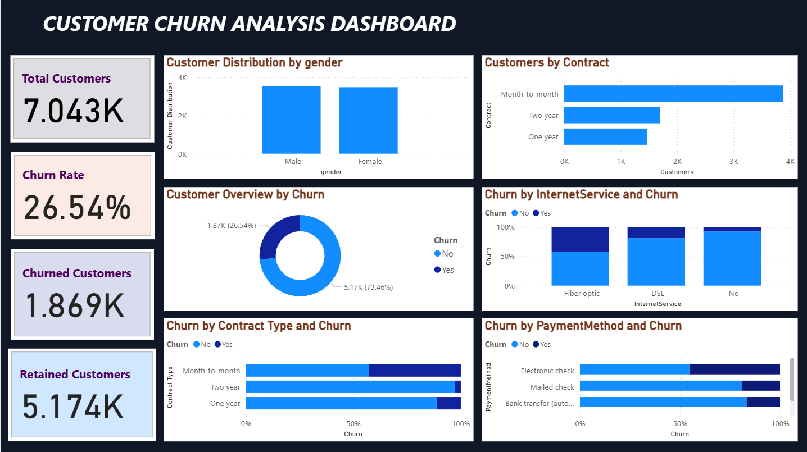

# Customer Churn Prediction Dashboard

## Project Overview
This project analyzes customer churn in a telecom company using Power BI. The dashboard provides insights into customer retention, churn rate, contract types, internet services, and payment methods.

## Objectives
- Analyze overall customer churn.
- Identify churned and retained customers.
- Understand churn patterns across contract types.
- Analyze churn based on internet service and payment methods.

## Tools Used
- Power BI
- DAX
- CSV Dataset

## Dashboard Highlights
- Total Customers
- Churn Rate
- Churned Customers
- Retained Customers
- Customer distribution by gender and contract
- Churn analysis by internet service, contract type, and payment method

## Dashboard Screenshot

CodTech InternID : CITS9803
